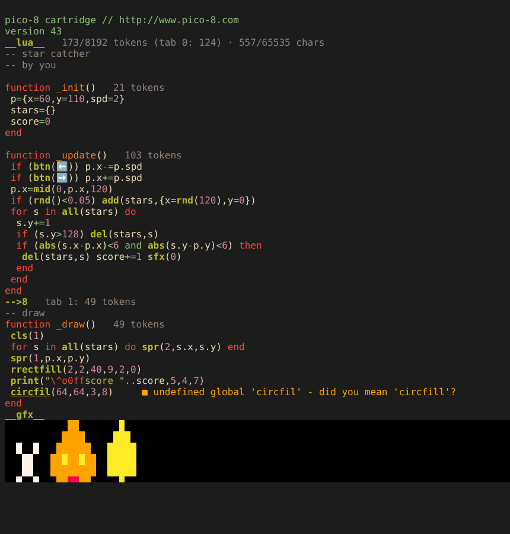

# pico8.nvim

PICO-8 **0.2.7** Unterstützung für Neovim: Tokenzähler, Autocomplete, Snippets,
Syntax-Highlighting und Diagnostics – komplett in Lua, ohne externe Programme.



## Features

- **Tokenzähler** – exakt nach PICO-8-Regeln (gegen
  [shrinko8](https://github.com/thisismypassport/shrinko8) verifiziert, auch für
  Carts mit über 8000 Tokens):
  - Gesamtzahl `1234/8192 tokens · 5678/65535 chars` als virtueller Text an `__lua__`
  - Tokens pro Code-Tab an jeder `-->8`-Zeile, optional pro Funktion
  - `#include`-Dateien werden mitgezählt, wie beim Ausführen in PICO-8
  - `:Pico8Tokens` Report (teuerste Funktionen), `:'<,'>Pico8Tokens` für eine Auswahl
  - Statusline-Komponente `require("pico8").statusline()`
- **Autocomplete** über einen eingebauten In-Process-Language-Server
  (kein externes Binary). Funktioniert mit blink.cmp, nvim-cmp
  (+ cmp-nvim-lsp), mini.completion, der eingebauten Neovim-LSP-Completion und `<C-x><C-o>`:
  - komplette 0.2.7-API mit Signaturen und Doku (inkl. `rrect`/`rrectfill`)
  - Platzhalter für Pflichtparameter: `spr(${1:n}, ${2:x}, ${3:y})`
  - Callbacks `_init`, `_update`, `_update60`, `_draw`
  - Button-Glyphen per Name: `left` → `⬅️`, `xbutton` → `❎`
  - eigene Funktionen/Variablen – auch aus `#include`-Dateien – und Tabellenfelder nach `.` / `:`
  - Dateinamen nach `#include `
- **Snippets** (43 Stück): Game-Loop, Cart-Gerüst, Klassen, Coroutines, Kollision,
  Partikel, State-Machine, Bewegung, P8SCII-Outline `\^o` / Underline `\^u` (neu in 0.2.7) …
  Im Autocomplete enthalten und zusätzlich als VSCode-Snippets (`package.json`) für LuaSnip & Co.
- **Syntax-Highlighting** für `.p8`-Carts:
  - PICO-8-Lua: `!=`, `+=`, `..=`, `\`, `^^`, `>>>`, `<<>`, `>><`, `@ % $`, `?`-Kurzform, `//`-Kommentare,
    Hex/Binär-Zahlen mit Nachkommastellen, Glyphen, `#include`, Labels
  - P8SCII-Steuercodes in Strings (`\f8`, `\#1`, `\^w`, `\^o8ff`, `\^u` …)
  - Cart-Sektionen; `__gfx__` und `__label__` werden in der PICO-8-Palette angezeigt (Sprites als Pixelart)
- **Diagnostics**:
  - Syntaxfehler (inkl. PICO-8-Kurzschreibweisen, `goto`/Labels, `break`, `...`)
  - Token- und Zeichenlimit überschritten
  - undefinierte Globals mit Vorschlag: `circfil` → `circfill`, `Spr` → `spr`, `⬅` → `⬅️`
  - Lua-Standardbibliothek, die es in PICO-8 nicht gibt: `math.floor` → `flr(x)`, `table.insert` → `add` …
  - `score += 1` ohne dass `score` je zugewiesen wird
  - zu viele Argumente für API-Funktionen
  - unbenutzte Locals / Funktionen / letzte Parameter (jedes kostet Tokens)
  - fehlende `#include`-Dateien und Fehler darin
- **Extras**: Hover-Doku (`K`) inkl. Tokenkosten eigener Funktionen, Hex/Binär-Anzeige von Zahlen,
  Speicheradressen (`0x5f2d` …) und `stat(n)`-Bedeutungen; Signaturhilfe; Go-to-Definition (auch in
  `#include`-Dateien); Referenzen; Umbenennen; Outline nach Tabs; `:Pico8Run`; Einrückung mit
  Kurzform-`if`; `:checkhealth pico8`.

## Voraussetzungen

- Neovim **0.10** oder neuer (getestet mit 0.10.4 und 0.11.4)
- optional: PICO-8 für `:Pico8Run`

## Installation

[lazy.nvim](https://github.com/folke/lazy.nvim):

```lua
{
  "DEIN-GITHUB-NAME/pico8.nvim", -- oder lokal: dir = "~/pfad/zu/pico8.nvim"
  ft = "pico8",
  opts = {}, -- optional, siehe Konfiguration
}
```

Ohne Plugin-Manager (native Packages):

```sh
git clone https://github.com/DEIN-GITHUB-NAME/pico8.nvim \
  ~/.local/share/nvim/site/pack/plugins/start/pico8.nvim
```

`setup()` ist optional – das Plugin funktioniert mit den Standardwerten.

Erkannt werden `*.p8` (Carts) sowie `*.p8.lua` (Code für `#include`).
Für andere `.lua`-Dateien z. B.:

```lua
vim.filetype.add({ pattern = { [".*/mein_spiel/.*%.lua"] = "pico8" } })
```

## Konfiguration

Standardwerte:

```lua
require("pico8").setup({
  pico8_path = nil,        -- Pfad zu PICO-8 für :Pico8Run (nil = $PATH + übliche Orte)
  run_args = {},           -- z. B. { "-windowed", "1" }

  lsp = { enabled = true }, -- eingebauter Language Server (Completion, Hover, ...)

  completion = {
    call_snippets = true,  -- Pflichtparameter als Platzhalter einfügen
    snippets = true,       -- Snippets im Autocomplete anbieten
    native = "auto",       -- Neovim-0.11-Autocomplete, wenn kein cmp/blink installiert ist
  },

  diagnostics = {
    enabled = true,
    debounce = 250,
    undefined_globals = true,
    unused = true,
    unused_params = true,     -- unbenutzter letzter Parameter
    unused_loop_vars = false,
    arg_count = true,
    globals = {},             -- zusätzliche bekannte Globals
  },

  tokens = {
    virtual_text = true,      -- Zähler an __lua__ und -->8
    function_hints = false,   -- Tokens pro Funktion
    warn_ratio = 0.9,         -- ab 90 % des Limits als Warnung färben
  },

  highlight = { gfx_colors = true }, -- __gfx__/__label__ in der PICO-8-Palette

  template = true,            -- neue, leere .p8-Dateien mit Cart-Gerüst füllen
})
```

### Autocomplete-Plugins

- **blink.cmp**: funktioniert direkt (LSP-Quelle ist standardmäßig aktiv).
- **nvim-cmp**: benötigt [cmp-nvim-lsp](https://github.com/hrsh7th/cmp-nvim-lsp) mit der Quelle `nvim_lsp`.
- **ohne Plugin**: Unter Neovim 0.11 wird die eingebaute LSP-Completion mit Auto-Trigger aktiviert,
  sonst `<C-x><C-o>`.
- **LuaSnip**: `require("luasnip.loaders.from_vscode").lazy_load()` lädt die Snippets aus
  `package.json`. Damit sie nicht doppelt erscheinen: `completion = { snippets = false }`.

### Tastenkürzel

Es gelten die normalen LSP-Kürzel – in Neovim 0.11 u. a. `K` (Hover), `grn` (Umbenennen),
`grr` (Referenzen), `gO` (Symbole), `<C-s>` (Signatur im Insert-Modus). Go-to-Definition z. B. so:

```lua
vim.api.nvim_create_autocmd("FileType", {
  pattern = "pico8",
  callback = function(ev)
    vim.keymap.set("n", "gd", vim.lsp.buf.definition, { buffer = ev.buf })
    vim.keymap.set("n", "<leader>r", "<cmd>Pico8Run<cr>", { buffer = ev.buf })
  end,
})
```

### Statusline

```lua
-- lualine
sections = { lualine_x = { function() return require("pico8").statusline() end } }
-- oder eigene Formatierung:
local s = require("pico8").stats() -- { tokens, total_tokens, chars, total_chars, tabs, ... }
```

## Befehle

| Befehl | Beschreibung |
| --- | --- |
| `:Pico8Tokens` | Token-/Zeichen-Report mit Tabs, `#include`s und den teuersten Funktionen |
| `:'<,'>Pico8Tokens` | Tokens der markierten Zeilen |
| `:Pico8Run` | speichert und startet das Cart in PICO-8 (bei `.lua`-Dateien das Cart, das sie inkludiert) |
| `:Pico8Docs [name]` | API-Doku als Float; ohne Argument ein Cheat-Sheet. Auch `:Pico8Docs stat` / `memory` |
| `:Pico8Toggle [virtual_text\|function_hints\|diagnostics]` | Anzeige umschalten |

## Diagnostics

| Code | Bedeutung |
| --- | --- |
| `syntax` | Syntaxfehler (erster Fehler, wie PICO-8) |
| `token-limit` / `char-limit` | mehr als 8192 Tokens / 65535 Zeichen (inkl. `#include`) |
| `include` | `#include`-Datei fehlt oder enthält einen Fehler |
| `undefined-global` | Global wird gelesen, aber nirgends zugewiesen |
| `stdlib` | Lua-Standardbibliothek (`math`, `string`, `table`, `require`, …) gibt es in PICO-8 nicht |
| `arg-count` | zu viele Argumente für eine API-Funktion |
| `unused` | unbenutzte Locals, lokale Funktionen, letzter Parameter |

Globals, die das Plugin nicht sehen kann, lassen sich im Code bekannt machen (kompatibel zu shrinko8):

```lua
--lint: my_global, other_global
```

Globals aus `#include`-Dateien sind automatisch bekannt. Für eine `.lua`-Datei sucht das Plugin
im selben und im übergeordneten Verzeichnis nach dem `.p8`-Cart, das sie inkludiert, und kennt dann
dessen Globals, die der anderen Includes und das Gesamt-Tokenbudget.

## Wie gezählt wird

Wie in PICO-8: Jeder Name, jedes Literal und jeder Operator zählt 1. Kostenlos sind `,` `.` `:` `;`
`::` schließende Klammern `)` `]` `}`, `end`, `local` und Kommentare. Ein `-` oder `~` direkt vor einer
Zahl gehört zur Zahl (`x=-1` sind 3 Tokens, `a - 1` ebenfalls 3, `x = - 1` aber 4).
Zeichen werden in P8SCII gezählt (`⬅️` ist ein Zeichen). Die komprimierte Größe für `.p8.png`
(Limit 15360 Bytes) berechnet nur PICO-8 selbst (`INFO`).

## Workflow-Tipps

- PICO-8 lädt eine extern geänderte `.p8` bei `CTRL-R` neu, sofern im PICO-8-Editor nichts ungespeichert ist.
- Code in `.lua`-Dateien auslagern und per `#include datei.lua` einbinden – das Plugin zählt Tokens
  und kennt Funktionen über Dateigrenzen hinweg (Completion, Hover, Go-to-Definition).
- `gf` auf dem Dateinamen einer `#include`-Zeile öffnet die Datei.

## Tests

```sh
make test            # oder:
nvim --headless -u tests/minimal_init.lua -c "luafile tests/run.lua"
```

## Lizenz

MIT
